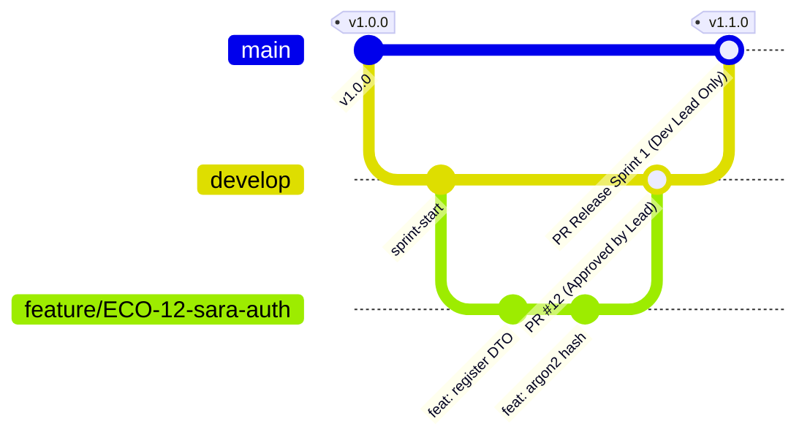
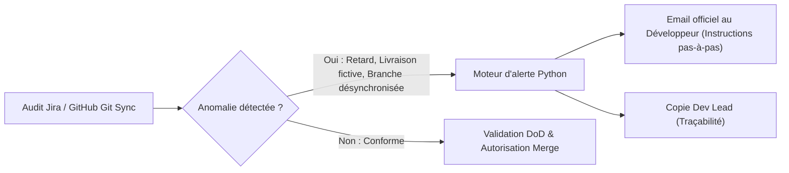

# 🛡️ ECOTRACK V2 — Protocole Officiel de Gouvernance Git, Branches & Alertes Dev Lead

Ce document constitue la **norme d'ingénierie logicielle obligatoire** régissant l'utilisation de Git, la gestion des branches, le cycle de vie des Pull Requests, et le système d'alerte automatisé pour l'ensemble de l'équipe **ECOTRACK V2**.

---

## 📌 Sommaire
1. [Architecture des Branches & Niveaux de Protection](#1-architecture-des-branches--niveaux-de-protection)
2. [Analyse Pédagogique : Branches de Feature vs Pull Request](#2-analyse-pédagogique--branches-de-feature-vs-pull-request)
3. [Protocole Quotidien du Développeur (Worktree & Synchronisation)](#3-protocole-quotidien-du-développeur-worktree--synchronisation)
4. [Definition of Done (DoD Gate) & Règle Anti-Mockup](#4-definition-of-done-dod-gate--règle-anti-mockup)
5. [Système d'Alerte Automatisé par Email (SMTP)](#5-système-dalerte-automatisé-par-email-smtp)
6. [Matrice des Droits et Responsabilités](#6-matrice-des-droits-et-responsabilités)

---

## 1. Architecture des Branches & Niveaux de Protection

Le projet adopte un modèle **Gitflow professionnel adapté aux cycles Scrum** composé de 4 types de branches :



### 1.1. Branche `main` (Production & Déploiement)
* **Rôle :** Code stable, testé et déployable en production.
* **Protection stricte (GitHub Ruleset + Classic Protection) :**
  * ❌ **Push direct strictement INTERDIT** à tout collaborateur standard.
  * ❌ **Suppression et Force Push (`git push -f`) interdits.**
  * 🔒 **Approbation obligatoire du Code Owner (`@ADEM2005373`)** via `.github/CODEOWNERS`.
  * 👑 **Seul le Lead Developer (`@ADEM2005373`)** possède le droit de bypass administratif et de fusionner (`merge`) dans `main`.

### 1.2. Branche `develop` (Intégration Continue de Sprint)
* **Rôle :** Branche de convergence où sont fusionnées toutes les fonctionnalités du sprint en cours.
* **Protection :**
  * ❌ **Push direct INTERDIT.** Aucune modification directe sans passer par une Pull Request.
  * 🔒 **Pull Request obligatoire** avec passage au vert de la suite de tests CI (`ci.yml`).
  * 🔒 **Revue et approbation obligatoire du Lead Developer.**
  * 🔄 **Rejet des approbations obsolètes** dès qu'un nouveau commit est poussé (`dismiss_stale_reviews`).

### 1.3. Branches de Feature (`feature/ECO-<ticket>-<prenom>-<slug>`)
* **Rôle :** Développement isolé d'un ticket Jira assigné.
* **Nommage obligatoire :**
  * Exemple : `feature/ECO-12-sara-auth-register`
  * Exemple : `feature/ECO-14-hiba-rs256-login`
  * Exemple : `feature/ECO-13-ahmed-mobile-auth`

### 1.4. Branches de Correction (`fix/ECO-...` et `hotfix/ECO-...`)
* `fix/` : Résolution d'un bug détecté lors de la revue de code sur `develop`.
* `hotfix/` : Correction d'urgence dérivée de `main`.

---

## 2. Analyse Pédagogique : Branches de Feature vs Pull Request

> [!IMPORTANT]
> **Réponse technique à la question du Lead :**
> *« Si un membre crée une nouvelle branche et veut pousser dessus sans faire de Pull Request, doit-on bloquer le push ? »*

### 2.1. Fonctionnement Mécanique de Git & GitHub
1. **GitHub ne peut pas créer une Pull Request à partir d'une branche qui n'existe que sur la machine locale du développeur.**
   * Pour ouvrir une Pull Request sur GitHub, la branche et ses commits doivent d'abord être envoyés sur le serveur (`git push origin feature/...`).
   * Si l'on bloquait le push sur une nouvelle branche de feature, le développeur serait dans l'incapacité totale d'envoyer son travail, et GitHub ne pourrait jamais lui afficher le bouton *"Create Pull Request"*.

2. **La Vraie Solution Professionnelle : Le "Draft PR dès le Jour 1"**
   * Au lieu de bloquer l'upload de la branche de travail, le protocole impose :
     * Dès que le développeur crée sa branche et pousse son premier commit, **il DOIT ouvrir immédiatement une Pull Request en mode "Draft" (Brouillon)** ciblant `develop`.
     * **Bénéfices immédiats :**
       * Synchronisation en temps réel de l'état du projet avec toute l'équipe.
       * Visibilité totale pour le Scrum Master / Lead Dev (zéro développement secret ou caché).
       * Déclenchement automatique des tests CI à chaque commit intermédiaire.
       * Impossible de fusionner tant que le développeur n'a pas basculé la PR en "Ready for Review" et que le Lead Dev ne l'a pas validée.

---

## 3. Protocole Quotidien du Développeur (Worktree & Synchronisation)

Chaque membre de l'équipe suit rigoureusement ces 5 étapes :

### Étape 1 : Création de la branche à partir du dernier état de `develop`
```bash
# Se placer sur develop et récupérer les dernières modifications de l'équipe
git checkout develop
git pull origin develop

# Créer sa branche dédiée au ticket Jira assigné
git checkout -b feature/ECO-XX-mon-prenom-nom-du-ticket
```

### Étape 2 : Commits réguliers et normalisés (Conventional Commits)
Chaque commit doit obligatoirement mentionner le numéro de ticket Jira :
```bash
git commit -m "feat(ECO-XX): implémentation du contrôleur de validation"
git commit -m "test(ECO-XX): ajout des tests unitaires Jest"
```

### Étape 3 : Premier push et ouverture immédiate de la Draft PR
```bash
git push -u origin feature/ECO-XX-mon-prenom-nom-du-ticket
```
* Aller sur GitHub et cliquer sur **Compare & pull request**.
* Sélectionner **Create Draft Pull Request** vers `develop`.

### Étape 4 : Synchronisation obligatoire avant demande de revue (Rebase / Merge)
Avant de solliciter la revue du Lead Dev, le développeur doit synchroniser sa branche avec les travaux récemment fusionnés sur `develop` :
```bash
git fetch origin
git merge origin/develop
# Résoudre les conflits éventuels en local et vérifier que les tests passent
npm test
git push origin feature/ECO-XX-mon-prenom-nom-du-ticket
```

### Étape 5 : Demande de Revue Officielle
* Sur GitHub, basculer la PR de *Draft* à **Ready for Review**.
* Assigner `@ADEM2005373` en Reviewer.
* Sur Jira, déplacer le ticket de `En cours` à `Revue en cours`.

---

## 4. Definition of Done (DoD Gate) & Règle Anti-Mockup

Un ticket ne peut **JAMAIS** être validé si l'une des conditions suivantes est violée :

1. **Règle absolue : « No Push / No Review = No Done »**
   * Un ticket marqué `Terminé` sur Jira sans commit pushed et sans PR validée par le Lead Dev est qualifié de **livraison fictive** et rejeté immédiatement.
2. **Interdiction des faux livrables (Mockups) :**
   * Aucun bouton tactile sans callback `onPress`.
   * Aucun formulaire sans validation et sans appel API fonctionnel.
   * Aucune route API renvoyant des données codées en dur sans traitement réel.
3. **Validation CI obligatoire :**
   * Linter et vérification des types TypeScript sans erreur.
   * Contrats d'API OpenAPI 3.1 validés.
   * Schéma SQL PostgreSQL et tests unitaires au vert.

---

## 5. Système d'Alerte Automatisé par Email (SMTP)

Le projet dispose d'un moteur d'alerte SMTP centralisé (`.agents/scripts/email_config.py`) connecté aux audits de gouvernance.



### 5.1. Cas de déclenchement des alertes automatiques :
1. **Livraison fictive :** Ticket passé à `Terminé` sur Jira sans PR ni commit sur GitHub.
2. **Branche désynchronisée :** Branche de feature inactive ou en retard de plus de 5 commits sur `develop`.
3. **Anomalie de revue de code :** Détection de code incomplet ou de mockups lors de l'exécution de `run_sprint_code_review.py`.
4. **Tentative de violation de gouvernance :** Push non autorisé ou tentative de contournement des règles de protection.

### 5.2. Annuaire officiel des membres & alertes :
| Membre | Rôle | Email Officiel | Identifiant GitHub |
| :--- | :--- | :--- | :--- |
| **Adem Ouerhani** | Lead Developer & Scrum Master | `ouerhaniadem0805@gmail.com` | `@ADEM2005373` |
| **Ahmed Salah** | Développeur Mobile & Data | `hmidsalah2005@gmail.com` | `@ah-med-sal-ah` |
| **Hiba Dhouib** | Développeuse Backend & IA | `hibadhouib6@gmail.com` | `@hibadh` |
| **Sara Shih** | Développeuse Fullstack Auth | `sarah.sou2016@gmail.com` | `@sarah-sahih` |

---

## 6. Matrice des Droits et Responsabilités

| Action Git / GitHub | Collaborateurs (Ahmed, Hiba, Sara) | Lead Developer (Adem Ouerhani) |
| :--- | :---: | :---: |
| Créer une branche de feature (`feature/ECO-...`) | ✅ Autorisé | ✅ Autorisé |
| Pousser sur sa propre branche de feature | ✅ Autorisé | ✅ Autorisé |
| Ouvrir une Pull Request vers `develop` | ✅ Obligatoire | ✅ Autorisé |
| Pousser directement sur `develop` sans PR | ❌ **Strictement Bloqué** | ⚠️ Bypass administratif si urgence |
| Pousser directement sur `main` sans PR | ❌ **Strictement Bloqué** | ⚠️ Bypass administratif réservé |
| Valider et fusionner dans `develop` | ❌ Non autorisé | ✅ **Seul Habilité** |
| Valider et fusionner dans `main` | ❌ Non autorisé | ✅ **Seul Habilité** |
| Déplacer un ticket vers `Terminé` sur Jira | ❌ Interdiction stricte | ✅ **Seul Habilité** |
