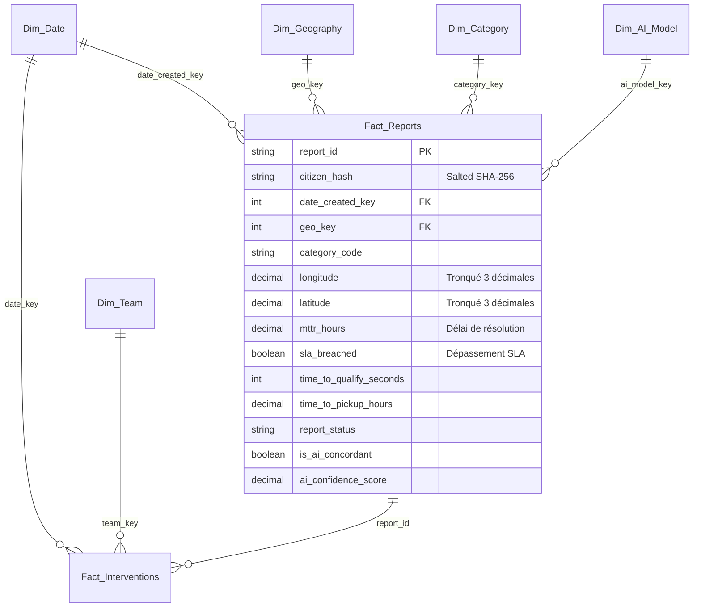

# 📊 Modèle de Données & Mesures DAX Power BI — ECOTRACK V2

Ce document constitue la **spécification officielle du modèle décisionnel et des mesures DAX (Data Analysis Expressions)** destinées aux tableaux de bord Power BI d'EcoTrack V2, conformément au Cahier des Charges Fonctionnel V2 (**US-09 : Modélisation Décisionnelle & Indicateurs de Performance**).

---

## 🎯 1. Public Cible & Objectifs Métier

* **Directeur Général des Services (DGS) & Maires :** Pilotage macroscopique, respect des délais réglementaires (SLA), vitesse moyenne de résolution (MTTR), cartographie des points noirs urbains.
* **Responsables des Brigades & Services Techniques :** Suivi de la charge de travail, productivité des équipes, temps de prise en charge terrain.
* **Gouvernance & MLOps :** Surveillance de la fiabilité des suggestions MobileNetV3 et taux de concordance humain/IA.

---

## 📐 2. Architecture du Modèle en Étoile (Star Schema)

Le modèle Power BI repose sur le Data Warehouse PostgreSQL 16 (`ecotrack_dw`), alimenté en continu par le pipeline CDC incrémental (`services/bi-etl`) avec anonymisation stricte (Salted SHA-256 pour les citoyens et troncature GPS à 3 décimales soit ~100m).



### 🔗 Cardinalités & Filtrage Croisé
* **Toutes les relations Dimensions $\rightarrow$ Faits :** Cardinalité `1 à plusieurs (1:*)`, direction de filtre croisé `Unique (Simple)`.
* **Dim_Date :** Marquée comme table de dates officielle dans Power BI (`Dim_Date[full_date]`).

---

## 🧮 3. Bibliothèque des Mesures DAX Officielles

### ⏱️ Section A : Délais & Respect des Engagements (SLA & MTTR)

#### 1. Délai Moyen de Résolution (MTTR en Heures)
Calcule le temps moyen écoulé entre le signalement citoyen et la clôture avec photo par l'ouvrier (T4).
```dax
MTTR_Moyen = 
AVERAGE(Fact_Reports[mttr_hours])
```

#### 2. Taux de Dépassement SLA (%)
Mesure le pourcentage de signalements n'ayant pas été traités dans le délai légal imparti (ex: 24h pour dépôt sauvage, 12h pour déchets dangereux).
```dax
Taux_Depassement_SLA = 
DIVIDE(
    CALCULATE(
        COUNTROWS(Fact_Reports), 
        Fact_Reports[sla_breached] = TRUE()
    ),
    COUNTROWS(Fact_Reports),
    0
) * 100
```

#### 3. Taux de Respect du SLA (%)
Complément direct du dépassement, cible contractuelle CDCF V2 : $\ge 90\%$.
```dax
Taux_Respect_SLA = 
100 - [Taux_Depassement_SLA]
```

#### 4. Délai Moyen de Prise en Charge (Time to Pickup en Heures)
Temps écoulé entre l'assignation par l'agent régulateur (T2) et le démarrage effectif des travaux sur site par l'ouvrier (T3).
```dax
Delai_Moyen_Prise_En_Charge_Heures = 
AVERAGE(Fact_Reports[time_to_pickup_hours])
```

#### 5. Délai Moyen de Qualification (Time to Triage en Minutes)
Temps écoulé entre la réception du signalement citoyen et sa validation par l'agent municipal (T1).
```dax
Delai_Moyen_Qualification_Minutes = 
DIVIDE(
    AVERAGE(Fact_Reports[time_to_qualify_seconds]),
    60,
    0
)
```

---

### 📦 Section B : Volumes d'Activité & Taux de Résolution

#### 6. Volume Total de Signalements
```dax
Volume_Total_Signalements = 
COUNTROWS(Fact_Reports)
```

#### 7. Volume de Signalements Résolus
```dax
Volume_Signalements_Resolus = 
CALCULATE(
    COUNTROWS(Fact_Reports),
    Fact_Reports[report_status] = "RESOLU"
)
```

#### 8. Taux de Résolution Global (%)
```dax
Taux_Resolution_Global = 
DIVIDE(
    [Volume_Signalements_Resolus],
    [Volume_Total_Signalements],
    0
) * 100
```

#### 9. Signalements en Cours de Traitement (Backlog Actif)
```dax
Signalements_En_Cours = 
CALCULATE(
    COUNTROWS(Fact_Reports),
    Fact_Reports[report_status] IN {"NOUVEAU", "EN_COURS_DE_VALIDATION", "VALIDE", "ASSIGNE", "EN_TRAITEMENT"}
)
```

#### 10. Nombre de Citoyens Uniques Actifs (RGPD Salted SHA-256)
Compte distinct des citoyens anonymisés ayant émis au moins un signalement sur la période.
```dax
Citoyens_Contributeurs_Uniques = 
DISTINCTCOUNT(Fact_Reports[citizen_hash])
```

---

### 🤖 Section C : Observabilité IA & MLOps

#### 11. Taux de Concordance IA vs Humain (%)
Pourcentage d'accord entre la catégorie prédite par MobileNetV3 et la catégorie finale confirmée par l'agent. Seuil d'alerte CDCF : $< 70\%$.
```dax
Taux_Concordance_IA = 
VAR TotalEvalues = 
    CALCULATE(
        COUNTROWS(Fact_Reports),
        NOT(ISBLANK(Fact_Reports[is_ai_concordant]))
    )
VAR TotalConcordants = 
    CALCULATE(
        COUNTROWS(Fact_Reports),
        Fact_Reports[is_ai_concordant] = TRUE()
    )
RETURN
    DIVIDE(TotalConcordants, TotalEvalues, 0) * 100
```

#### 12. Score de Confiance Moyen IA
```dax
Score_Confiance_Moyen_IA = 
AVERAGE(Fact_Reports[ai_confidence_score]) * 100
```

---

### 📅 Section D : Time Intelligence (Analyse Temporelle)

#### 13. Signalements MTD (Month-To-Date)
```dax
Signalements_MTD = 
TOTALMTD([Volume_Total_Signalements], Dim_Date[full_date])
```

#### 14. Signalements YTD (Year-To-Date)
```dax
Signalements_YTD = 
TOTALYTD([Volume_Total_Signalements], Dim_Date[full_date])
```

#### 15. Signalements du Mois Précédent
```dax
Signalements_Mois_Precedent = 
CALCULATE(
    [Volume_Total_Signalements],
    DATEADD(Dim_Date[full_date], -1, MONTH)
)
```

#### 16. Évolution Mensuelle des Signalements (%)
```dax
Evolution_Mensuelle_Signalements_% = 
VAR MoisActuel = [Volume_Total_Signalements]
VAR MoisPrecedent = [Signalements_Mois_Precedent]
RETURN
    DIVIDE(MoisActuel - MoisPrecedent, MoisPrecedent, 0) * 100
```

---

## 🔒 4. Sécurité au Niveau des Lignes (Row-Level Security - RLS)

Afin de garantir le cloisonnement des données par arrondissement municipal, le modèle met en œuvre la sécurité RLS suivante :

### Rôle 1 : `Direction_Generale_DGS`
Accès complet sans filtre à l'ensemble du territoire communal.
* **Expression DAX sur Dim_Geography :** *Aucune restriction (accès total).*

### Rôle 2 : `Mairie_Arrondissement`
Filtre dynamique restreignant l'accès aux signalements relevant de la circonscription de l'élu connecté.
* **Expression DAX sur Dim_Geography :**
  ```dax
  [district_code] = USERPRINCIPALNAME()
  ```

### Rôle 3 : `Chef_Equipe_Proprete`
Filtre restreignant l'affichage aux interventions gérées par l'équipe de l'utilisateur.
* **Expression DAX sur Dim_Team :**
  ```dax
  [team_code] = USERPRINCIPALNAME()
  ```

---

## 🎨 5. Charte Graphique & Visualisations Recommandées (CDCF V2)

| Indicateur (KPI) | Type de Visuel Power BI | Couleur Standard | Seuil d'Alerte |
| :--- | :--- | :--- | :--- |
| **Taux Respect SLA** | Carte KPI / Jauge | Émeraude (`#059669`) | $< 90\%$ (Ambre / Rouge) |
| **MTTR Moyen** | Carte numérique | Bleu Marine (`#1E3A8A`) | $> 24.0\text{ h}$ |
| **Concordance IA** | Anneau (Donut Chart) | Violet (`#7C3AED`) | $< 70\%$ (Alerte MLOps) |
| **Cartographie Urbaine** | Carte Azure / Mapbox | Gradient Chaleur | Coordonnées floutées ~100m |
| **Tendance Mensuelle** | Graphique en Aires | Cyan / Indigo | $+20\%$ vs $M-1$ |
