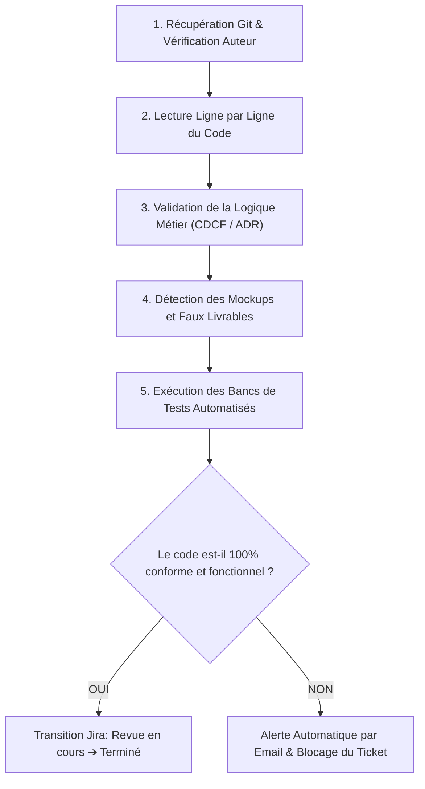

# 🛡️ Protocole Officiel de Revue de Code & Gouvernance Agile — ECOTRACK V2

Ce document constitue la **norme officielle et obligatoire** de revue de code (Code Review SOP) et de gouvernance de projet, applicable à la clôture de chaque sprint par le **Lead Developer & Scrum Master (Adem Ouerhani)**.

---

## 🎯 1. Principes Fondamentaux de Gouvernance

1. **Règle d'or : « No Push / No Review = No Done »**
   * Aucun ticket ne peut être marqué comme `Terminé` sur Jira sans commit pushed, sans branche de feature dédiée, et sans validation préalable du Lead Developer.
2. **Règle Cardinale Pédagogique : « Ne Jamais Corriger à la Place du Développeur »**
   * **Stricte interdiction pour le Lead Dev / IA de modifier ou corriger le code défaillant d'un membre.**
   * En cas d'erreur, de bug, de mockup ou d'omission détecté lors de la revue :
     1. Le code défaillant reste **intact** (zéro modification par le Lead Dev).
     2. Un **e-mail d'alerte pédagogique officiel** est envoyé immédiatement au développeur assigné.
     3. L'e-mail détaille obligatoirement : l'erreur exacte (fichier, ligne), le problème de logique, et le **guide pas-à-pas pour la corriger**.
     4. Le développeur doit impérativement corriger lui-même sur sa machine, commiter avec son propre compte Git, et soumettre à nouveau en `Revue en cours`.
3. **Principe de Répartition des Responsabilités :**
   * **Développeurs (Ahmed Salah, Hiba Dhouib, Sara Sahih) :**
     * Accès en lecture à leurs tickets.
     * Déplacement autorisé : `À faire` $\rightarrow$ `En cours` $\rightarrow$ `Revue en cours`.
     * **INTERDICTION FORMELLE** de déplacer un ticket vers `Terminé`.
   * **Lead Developer & Scrum Master (Adem Ouerhani) :**
     * Seul administrateur habilité à valider la Definition of Done et à effectuer la transition : `Revue en cours` $\rightarrow$ `Terminé`.

---

## 📋 2. Les 7 Étapes de la Méthode de Revue de Code (Ligne par Ligne)

Pour chaque ticket soumis en `Revue en cours`, le Lead Developer applique la méthode suivante :



### Étape 1 : Vérification de la Traçabilité Git
* Vérifier l'existence d'une branche respectant la convention : `feature/ECO-XX-prenom-description`.
* Vérifier la signature de l'auteur dans l'historique Git (`git log --format="%an <%ae>"`).
* **Règle anti-fraude :** Un commit poussé par un tiers ou non attribué à l'assigné est rejeté ou requiert une requalification en Pair-Programming.

### Étape 2 : Lecture Ligne par Ligne du Code Source
* Analyser l'implémentation sans survol :
  * Types et interfaces (`packages/shared`).
  * Schémas de données et contraintes d'intégrité (`packages/db`).
  * Contrôleurs, routes, middlewares et gestion des erreurs (`services/*`).
  * Composants d'interface, gestion des états et hooks (`apps/*`).

### Étape 3 : Contrôle de la Logique Métier
* Conformité stricte aux **Architecture Decision Records (ADR)** :
  * **ADR-01 :** Séparation MongoDB 2dsphere / PostgreSQL Star Schema.
  * **ADR-02 :** JWT RS256 asymétrique + Argon2id (64 MiB, 3 passes) + Rate limiting.
  * **ADR-03 :** Machine à états finis (Transitions T1 à T5).
  * **ADR-04 :** Découplage de l'inférence IA Vision via FastAPI.
  * **ADR-05 :** Purge EXIF/GPS systématique et anonymisation SHA-256 (RGPD).

### Étape 4 : Détection des Mockups et Implémentations Incomplètes
Sont formellement qualifiés de **livrables incomplets** :
* Boutons tactiles ou web sans callback `onPress` ou `onClick`.
* Écrans ou formulaires statiques sans liaison avec une API distante.
* Méthodes ou routes retournant des valeurs factices codées en dur sans traitement réel.
* Modèles IA sans chargement de poids effectif ou sans seuils de confiance.

### Étape 5 : Exécution des Bancs de Tests & Vérification Runtime
* Exécuter la suite de tests automatisée du sprint correspondant :
  * Sprint 1 : `python .agents/scripts/test_sprint1_tickets.py`
  * Sprint 2 : `python .agents/scripts/test_sprint2_tickets.py`
  * Validation globale : `python .agents/scripts/run_sprint_code_review.py`
* 100% des assertions doivent être au vert (`[PASS]`).

### Étape 6 : Décision & Transition Jira
* **Si conforme (100% PASS & DoD respectée) :** Le Scrum Master passe le ticket de `Revue en cours` à `Terminé` sur Jira.
* **Si non conforme (Erreur, Bug, Mockup, Manque) :**
  * **Interdiction formelle de corriger le code de l'assigné.**
  * Le ticket est renvoyé en `En cours` sur Jira.
  * L'alerte e-mail est expédiée avec les directives de correction.

### Étape 7 : Notification & Alerte Pédagogique par Email (Automatisée)
* Envoi d'un e-mail d'alerte SMTP détaillé à l'assigné contenant :
  1. Le fichier et la ligne exacte posant problème.
  2. L'explication technique du bug ou du manque.
  3. Le **guide de correction pas-à-pas (How to fix)** pour qu'il code la solution lui-même.
  4. L'échéance de correction (24h) et la commande de push avec son compte Git.

---

## 🛠️ 3. Commandes d'Exécution Rapide

Le Lead Developer peut lancer la revue automatique à tout moment via le terminal :

```powershell
# Exécuter la revue complète du sprint actif
npm run review:sprint

# Ou directement en Python
python .agents/scripts/run_sprint_code_review.py

# Exécuter la revue avec déclenchement des alertes e-mails automatiques
python .agents/scripts/run_sprint_code_review.py --alert
```

---

## 🔒 4. Configuration du Verrouillage Workflow sur Atlassian Jira

* **Projet :** `SCRUM` (ECOTRACK V2)
* **Lead du projet :** Adem Ouerhani
* **Règle de transition Jira :**
  * Transition : `* ➔ Terminé(e)`
  * Condition / Règle : `Restrict who can move an issue`
  * Rôle autorisé : `Administrator` uniquement.
